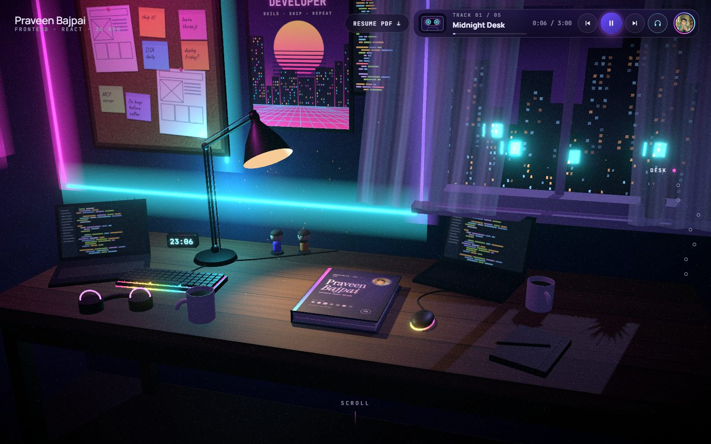
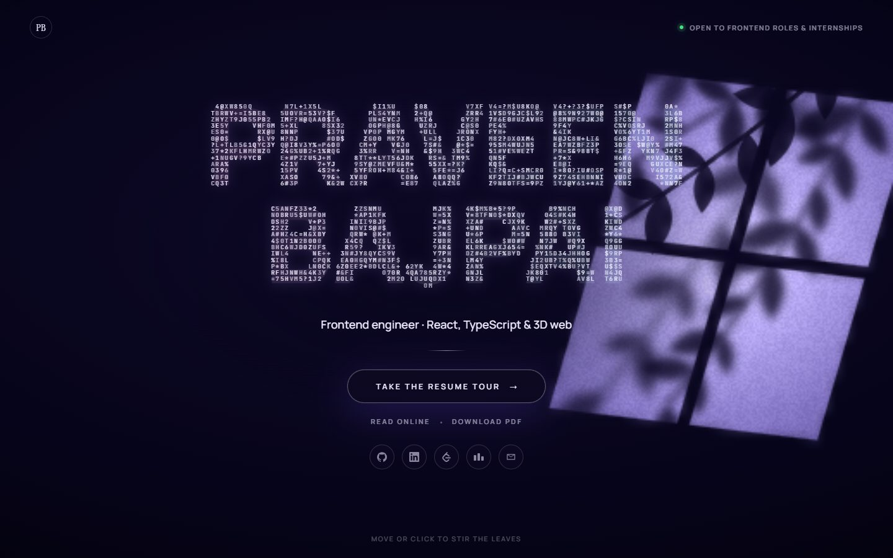
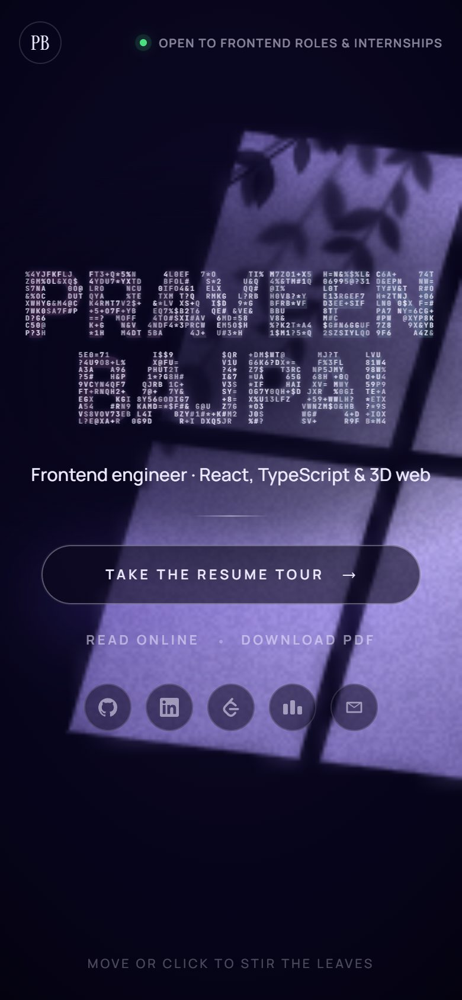
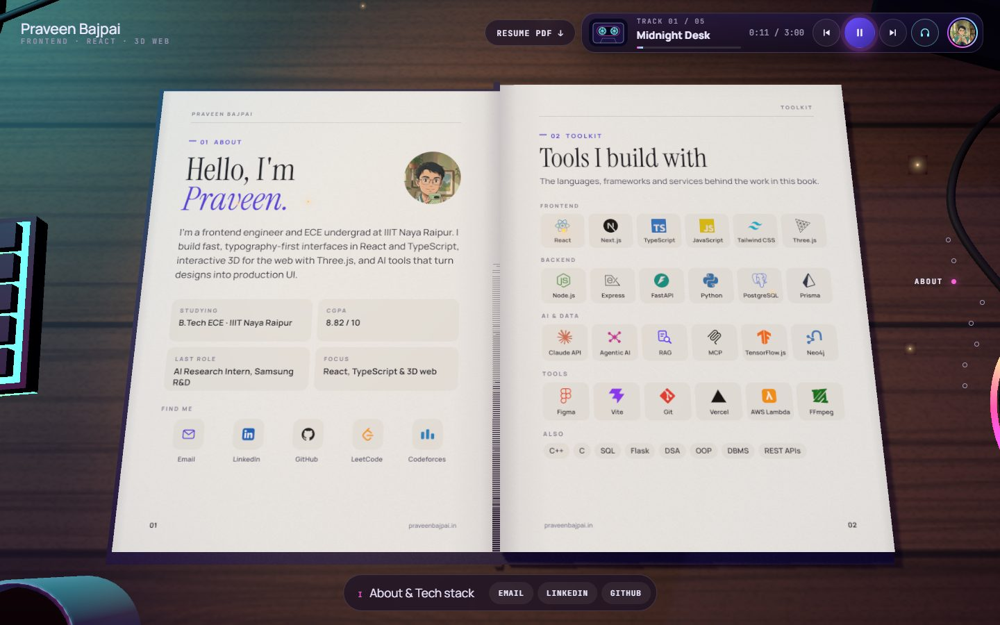
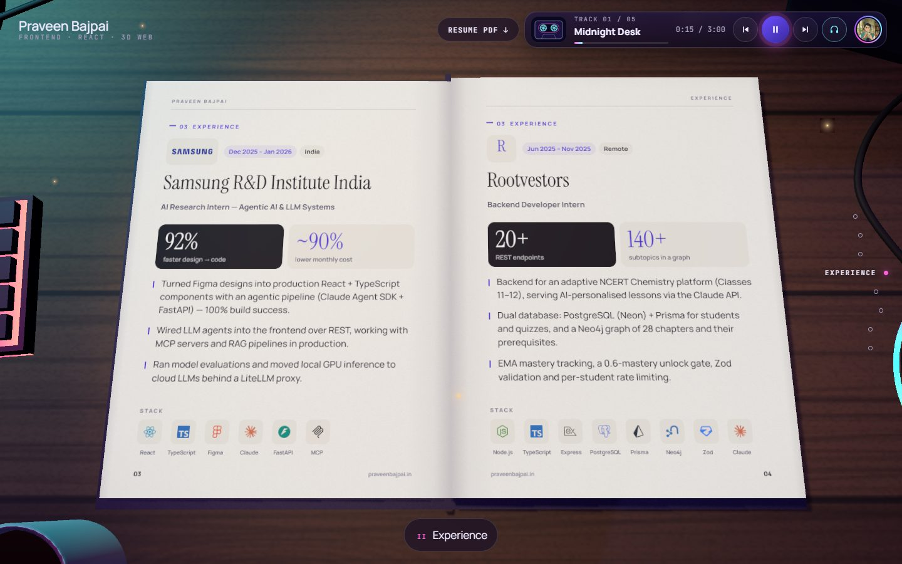
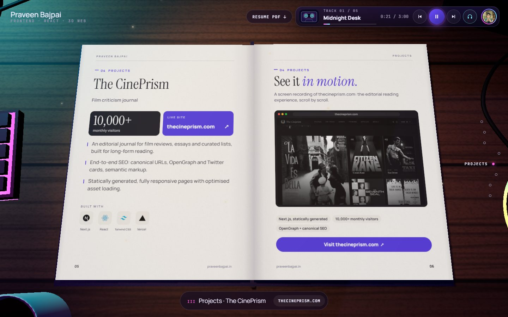
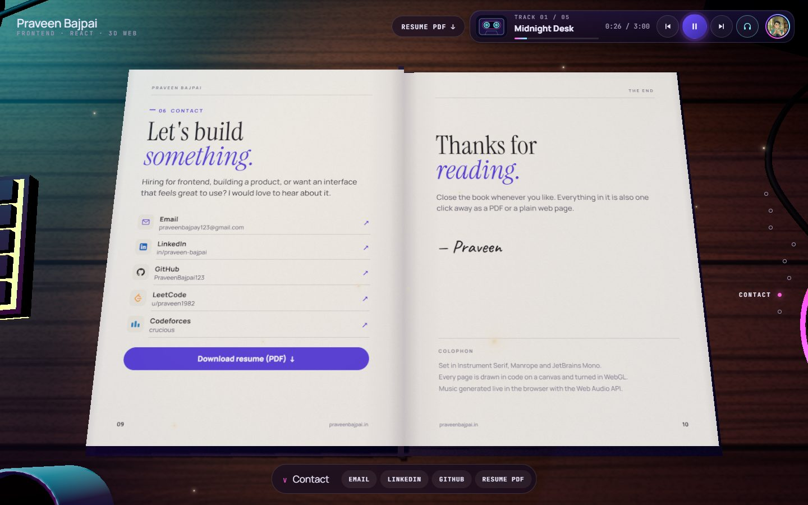
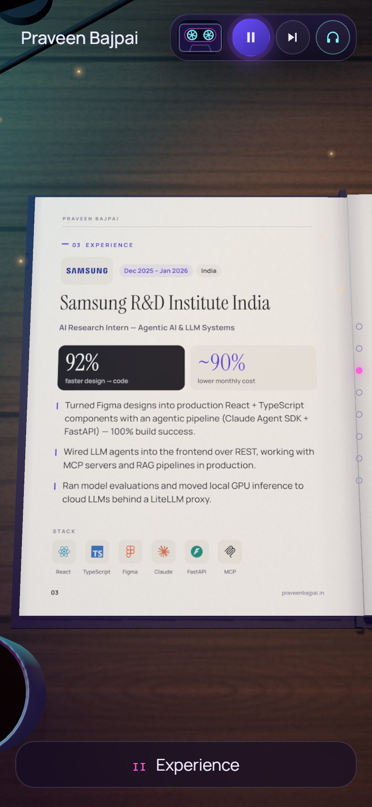
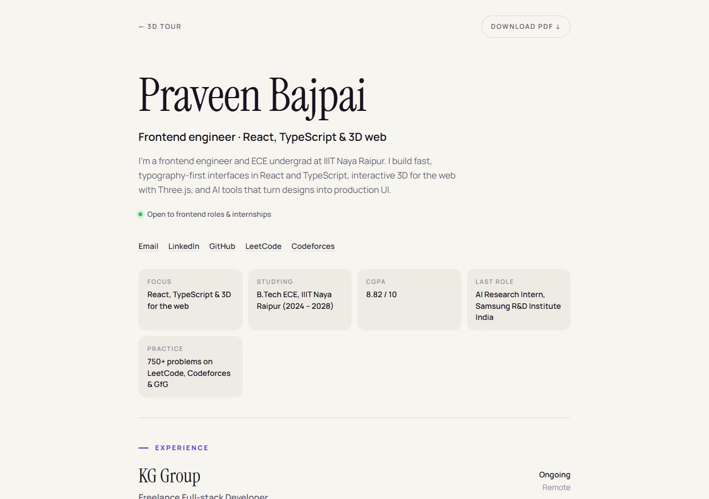

# Praveen Bajpai — 3D resume portfolio

**Live: [praveenbajpai.in](https://praveenbajpai.in)** · Plain version: [praveenbajpai.in/resume](https://praveenbajpai.in/resume)

A frontend portfolio you scroll through like a short film. You land on a quiet title card in
dappled window light, then fly into a neon-lit developer's desk at night and read the resume
in a book: scrolling turns the pages, one project page plays a recording of the live site, and
the book closes when you reach the end. A cassette-style player runs a soundtrack that is
generated live in the browser.



## Screenshots

| Landing page | Phone |
|---|---|
|  |  |

| About & toolkit | Experience |
|---|---|
|  |  |

| Project with a live recording | Contact & the end |
|---|---|
|  |  |

| Reading on a phone (one page at a time) | `/resume`: the fast, plain version |
|---|---|
|  |  |

## What's in it

- **Landing page:** the name drawn in constantly changing characters over a soft silhouette of
  the letters, on a canvas of window light and leaf shadows that stir when you move the mouse
  or click. One button starts the tour; a thin line along its edge shows loading progress.
- **The room:** desk, lamp, curtains moving in the breeze, neon strips, fairy lights, a city
  skyline, RGB keyboard and a leather book with the portrait on its cover, all built in code
  with React Three Fiber.
- **The book:** five spreads (About & Toolkit, Experience, CinePrism, AI Editor & Education,
  Contact & the end). Pages are drawn on canvas from one content file, with brand icons, stat
  tiles and clickable links on the paper itself.
- **Video on a page:** the CinePrism page plays a screen recording of the live site. Each video
  frame is copied into just that rectangle of the page's texture, so it keeps playing while the
  page bends and turns.
- **Music:** five generated ambient tracks plus wind, with play/pause, next/previous and an
  ambience switch on the cassette player.
- **For recruiters and search engines:** `/resume` is a static HTML page built from the same
  content at build time, with a downloadable PDF, structured data (schema.org `Person`),
  OpenGraph/Twitter cards, `robots.txt` and a sitemap.
- **Accessible:** a full semantic text version for screen readers, keyboard-reachable
  controls, and reduced motion respected (no animation, video shows a still frame).

## Tech stack

React 19 · Three.js · React Three Fiber · drei · postprocessing · Vite · Lenis (smooth scroll) ·
zustand · Canvas 2D · Web Audio API · Simple Icons · Vercel

## How it works

| Piece | Where |
|---|---|
| All resume text (book, `/resume`, screen-reader version, search data) | `src/content.js` |
| Book pages drawn on canvas | `src/lib/pages.js` |
| Book cover | `coverTexture` in `src/lib/textures.js` |
| Book geometry, page turning, links on pages | `src/scene/Book.jsx` |
| Video copied into a page texture | `src/scene/PageVideo.jsx` |
| Scroll timeline (when pages turn) and chapters | `src/lib/scroll.js` |
| Camera shots | `src/scene/CameraRig.jsx` |
| Landing page | `src/ui/Landing.jsx`, `src/ui/AsciiName.jsx`, `src/ui/DappledLight.jsx`, `src/ui/landing.css` |
| Music player and generated music | `src/ui/MusicPlayer.jsx`, `src/lib/audio.js` |
| `/resume` page and structured data | `resume-page.js` (a Vite plugin) |

## Run it locally

```bash
npm install
npm run dev        # http://localhost:5173
npm run build      # production files in dist/
```

Dev helpers:

- `?page=all` (or `?page=<id>`, e.g. `?page=samsung`) shows the book pages as flat images.
- `?perf` shows a live readout of frame rate, draw calls, GPU memory and JS heap.

## Editing content

- **Text:** everything lives in `src/content.js`. The book, `/resume`, the hidden screen-reader
  version and the search data all update from it.
- **Photo:** `public/photo.jpg` (square, about 400×400). It appears on the landing page, the
  cover, the About page and the music player.
- **Resume PDF:** `public/praveen-bajpai-resume.pdf`.
- **Share image:** `public/og.jpg` (1200×630).
- **Project video:** `public/media/cineprism.mp4` (792×496, H.264) and its still frame
  `cineprism-poster.jpg`. A replacement must keep the same pixel size, because it is copied
  1:1 into the page texture.

## Tuning

| What | Where |
|---|---|
| When pages turn, scroll length | `T` in `src/lib/scroll.js`, `.scroll-track` height in `src/styles.css` |
| Lamp brightness / colour | `<spotLight>` in `src/scene/Lamp.jsx` |
| Moonlight | `Moonlight` in `src/scene/Scene.jsx` |
| Curtain motion | `src/scene/Curtain.jsx` |
| Music, wind and page-turn loudness | `LEVELS` in `src/lib/audio.js` |
| Tracks (names, chords, tempo) | `TRACKS` in `src/lib/audio.js` |
| Neon strips, fairy lights, wall decor | `src/scene/Decor.jsx` (textures in `src/lib/decor.js`) |
| Keyboard, mouse, headphones, figurines | `src/scene/Gear.jsx` |
| Gust rhythm (shared by curtains and sound) | `src/lib/wind.js` |
| Landing light (colour, wind, grain) | `OPT` in `src/ui/DappledLight.jsx` |

## Performance

- The 3D scene is split into its own chunk and loads behind the landing page. Shaders compile
  in the background while the pages are painted, so the tour opens without a stall.
- Rendering is on demand: full frame rate only while something moves, 30 fps when idle
  (`IDLE_FPS` in `src/lib/perf.js`), and nothing behind the landing page or in a background tab.
- Shadow maps are drawn once and refreshed only while pages turn.
- Resolution adapts: lower in the room, sharper while reading. Quality steps down
  automatically on slow devices.
- The project video downloads only when the visitor nears the projects.

## Deploy

Hosted on Vercel (`vercel.json` sets caching headers and redirects `www` to the bare domain):

```bash
npx vercel --prod
```

See `PLAN.md` for the original design notes.
